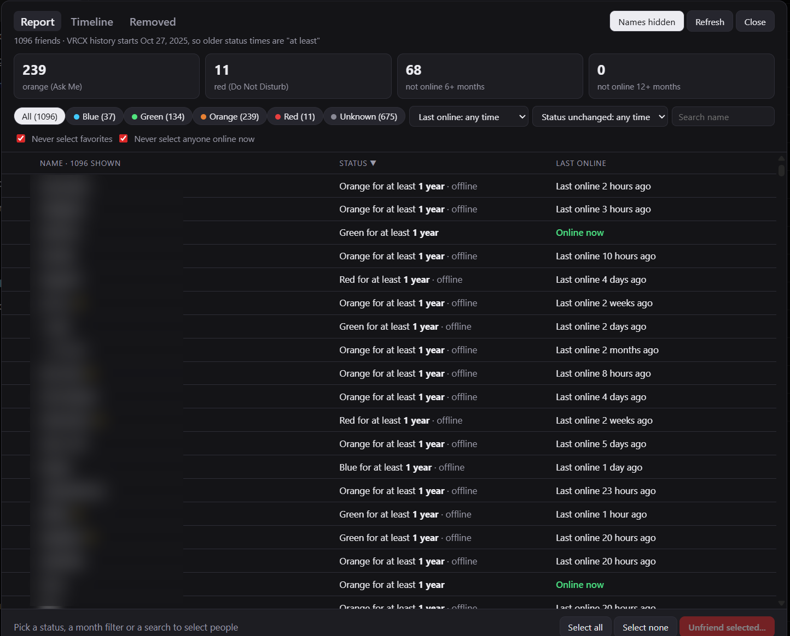
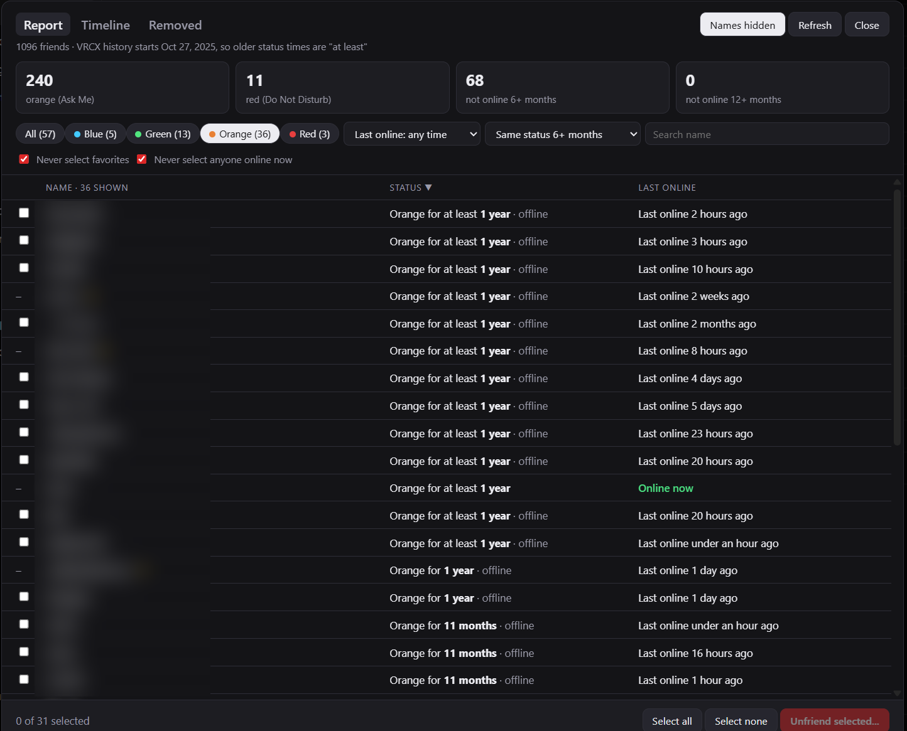
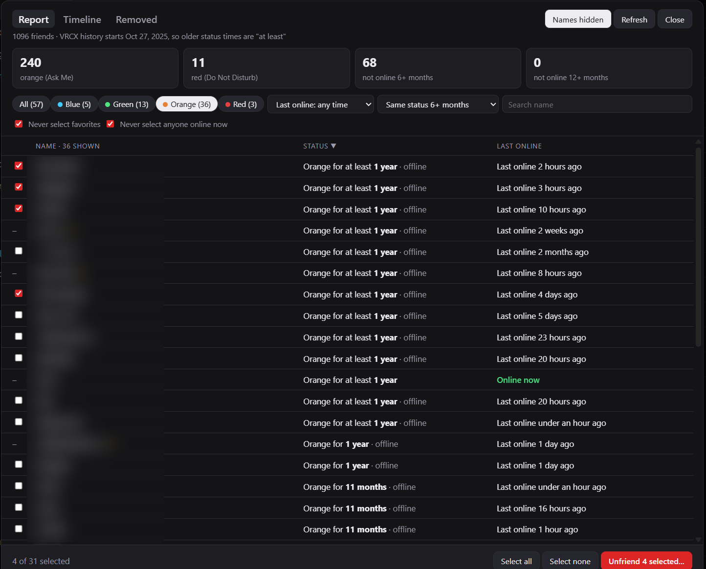
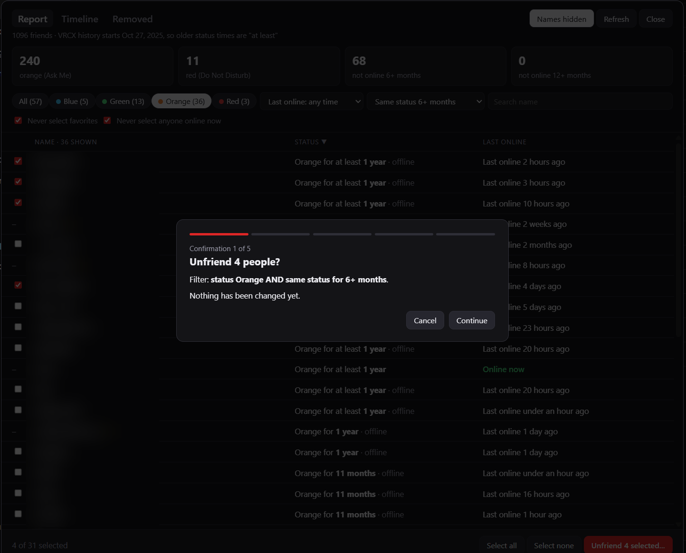
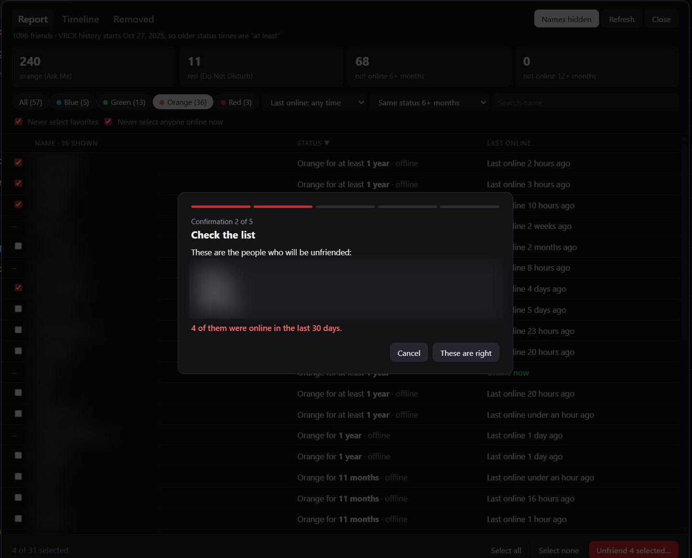
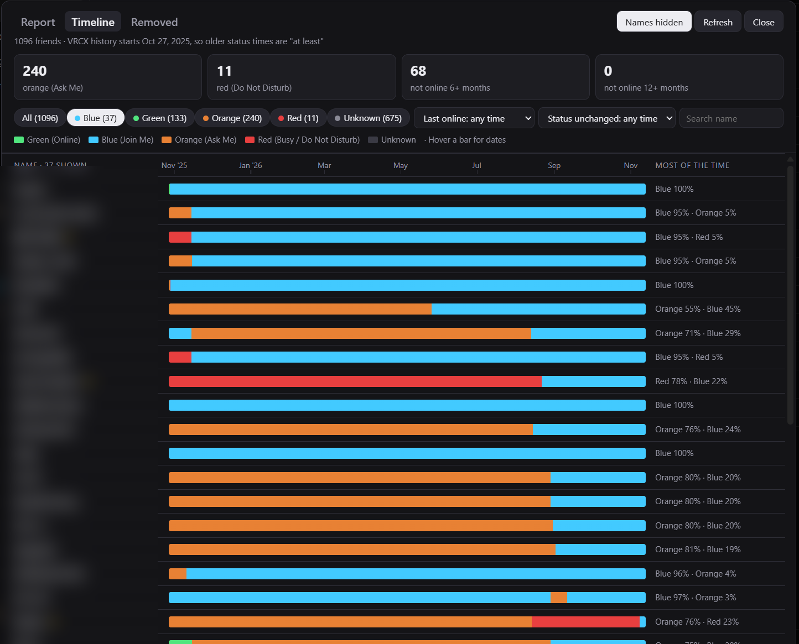
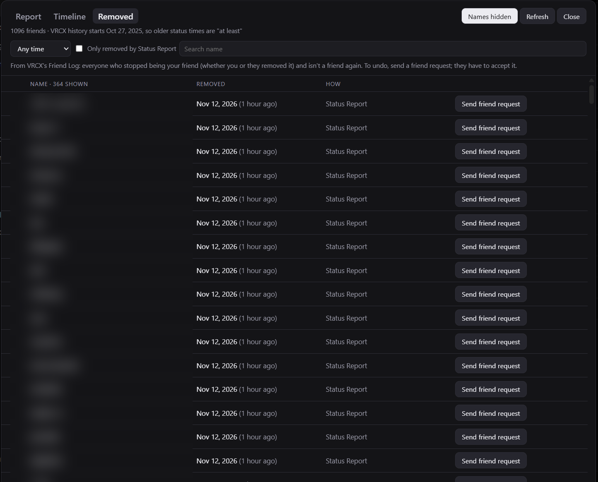

# VRCX Status Report

A friends-list cleanup tool that runs **inside [VRCX](https://github.com/vrcx-team/VRCX)**.

Find friends who have sat on **Orange (Ask Me)** or **Red (Do Not Disturb)** for months, or who haven't been online in a long time, and remove them in bulk, with protections against removing the wrong people and a record of everyone removed.

> [!CAUTION]
> **All data comes strictly from VRCX.** Status durations, last-online times, time together, joins, mutuals and the removed list are all read from VRCX's own local records. VRCX only records what it sees while it is running and logged in, so if your VRCX history is short, has gaps, or was reset, these numbers can be inaccurate (for example, someone may have been on a status longer than shown, or been online while VRCX was closed). Check people before removing them. Unfriending is permanent. **Use this tool at your own risk.**



> **Not affiliated with VRChat or the VRCX team.** This is a community script that uses VRCX's custom-script support. Unfriending is permanent; read [Safety](#safety) before unfriending anyone.

---

## Contents

- [Features](#features)
- [Screenshots](#screenshots)
- [Quick start](#quick-start)
- [How it works](#how-it-works)
- [Requirements](#requirements)
- [Installation](#installation)
- [Usage](#usage)
- [Status colours](#status-colours)
- [Safety](#safety)
- [Limitations](#limitations)
- [Uninstalling](#uninstalling)
- [Standalone scripts](#standalone-scripts)
- [Privacy](#privacy)
- [Troubleshooting](#troubleshooting)
- [License](#license)

---

## Features

The panel has three tabs:

| Tab | What it does |
|---|---|
| **Report** | Lists every friend with the status they have set, how long it has stayed the same, and when they were last online. Filter by status, and with two month sliders, **status unchanged for** and **not online for** (any range from 1 to 12+ months each), then tick people and unfriend them. |
| **Timeline** | One coloured bar per friend showing their status history over time. Hover for exact dates; a *Most of the time* column sums each person up (e.g. *Orange 71% · Green 29%*). |
| **Removed** | Everyone who is no longer your friend, taken from VRCX's Friend Log, with a **Send friend request** button to undo a removal. |

Also:

- **Built into VRCX:** opens from a **Status Report** entry in VRCX's left sidebar (below **Tools**) or with **Ctrl+Shift+O**. It matches VRCX's look and works in any VRCX language.
- **Filters by the status people have set:** Blue, Green, Orange or Red, whether they're online or offline. VRChat keeps a status set while someone is offline.
- **Nothing is selected until you tick it**, and favorites and anyone online right now can't be ticked unless you turn that off.
- **4-step confirmation** before any unfriending, ending with typing the number of people, with a speed choice and automatic slow-down if VRChat asks for it.
- **Always current:** data reloads when you open the panel or change a filter.
- **Time together and joins** for every friend, from VRCX's game log: the same numbers VRCX shows on a profile.

## Screenshots

Friend names are blurred in these screenshots.

| Filter: Orange, same status 6+ months | Ticking people to remove |
|---|---|
|  |  |
| **Confirmation: summary** | **Confirmation: check the list** |
|  |  |
| **Timeline** | **Removed** |
|  |  |

## Quick start

To remove everyone who has been **Orange for 6+ months**:

1. Open **Status Report** in the VRCX sidebar.
2. Click **Orange**, then set **Same status 6+ months**.
3. Look through the list and tick the people to remove, or click **Select all** and untick anyone to keep.
4. Click **Unfriend N selected…** and go through the 4 confirmations.

Other useful combinations:

- **Red + Same status 3+ months**
- **All + Not online for 12+ months** (everyone inactive for a year, whatever their status)
- **Orange + Not online for 3–6 months** (drag both slider handles to pick a range)
- **Orange + Never met** (orange friends you've never been in an instance with)
- **Orange + Not online for 6+ months**

## How it works

VRCX loads a file called `custom.js` from its data folder at startup and runs it inside its window. This project's `status-report.js` is installed as that file. It reads:

| Data | Source |
|---|---|
| Status changes, online/offline events, unfriend log | VRCX's local database (`%AppData%\VRCX\VRCX.sqlite3`), read with `SELECT` queries. The only write: after an unfriend, the same Friend Log entry VRCX itself would add (see Safety) |
| Current status, online state, last login, favorites | VRCX's live friend list (already loaded from VRChat by VRCX) |
| Time together, joins | VRCX's game log (`gamelog_join_leave`), the same data VRCX uses for a profile's time spent and join count |
| Mutuals | VRCX's mutual friends graph (*Charts → Mutual Friends*), counted the same way as the *Mutual friends* column in VRCX's friend list |

The script only talks to VRChat for the two actions you explicitly confirm: **unfriending** and **sending a friend request**. Both go through VRCX's own request service, using your existing VRCX login. The script doesn't read or store passwords or tokens.

## Requirements

- **Windows** with **VRCX** installed and logged in. Tested on VRCX **2026.09.16**.
- VRCX should have been running for a while: status history only goes back to when *your* VRCX started recording (see [Limitations](#limitations)).
- Optional: **Python 3.9+** for the [standalone scripts](#standalone-scripts).

## Installation

### Option 1: install script (recommended)

1. Download or clone this repository.
2. In the repository folder, run:

   ```powershell
   powershell -ExecutionPolicy Bypass -File .\install.ps1
   ```

   This copies `status-report.js` to `%AppData%\VRCX\custom.js`. If you already had a different `custom.js`, it's backed up first as `custom.js.bak-<date>`.
3. **Restart VRCX.**

### Option 2: manual

1. Copy `status-report.js` from this repository to the path below, **renamed to `custom.js`** (VRCX only loads a file with that exact name):

   ```
   %AppData%\VRCX\custom.js
   ```

   (Paste `%AppData%\VRCX` into the File Explorer address bar to open the folder.)
2. **Restart VRCX.**

> VRCX only loads one `custom.js`. If you already use one for something else, you'll need to combine them.

### Updating

Pull or download the latest version, run the install script again (or copy `status-report.js` to `custom.js` again), then restart VRCX.

## Usage

Open **Status Report** in the VRCX sidebar or press **Ctrl+Shift+O**. **Esc** or **Close** closes the panel; **Refresh** reloads the data.

### Report

**Cards** at the top count *orange (Ask Me)*, *red (Do Not Disturb)*, *not online 6+ months* and *not online 12+ months*. Click one to filter to it (the two *not online* cards set the slider for you).

The panel fills the VRCX window. All filters live in the **Filters** sidebar on the left; the filters that are on show as **pills** above the list. Click **×** on a pill to remove that filter, or **Reset all** / **Clear all** to start over.

**Filters sidebar:**

| Filter | Options |
|---|---|
| Search | Matches display names |
| Status | All · Blue · Green · Orange · Red, with counts. *Unknown* also appears if VRCX has never recorded a status for some friends. Counts follow the other filters. |
| Status unchanged for | Same slider as below: tick the box, then drag the handles, e.g. *3–6 months* or *12+ months*. Unticked means any. |
| Not online for | Tick the box, then drag the two handles to set a range from **1** to **12+** months, e.g. *3–6 months* or *6+ months*. With the right handle at 12+ there's no upper limit. Unticked means any time. |
| Time together | Any, Never met, Under 1 h or Under 10 h |
| Protection: Never select favorites / anyone online now | On by default. Those people still appear in the list, but with a dash instead of a checkbox. |

**Each row shows:**

| Column | Example |
|---|---|
| Name | Click it to open their VRCX profile. ★ marks a favorite. |
| Status | *Orange for at least 1 year · offline* |
| Last online | *Online now*, *Last online 3 months ago*, or *Not seen online since …* |
| Time together | Total time you've spent in the same instance, e.g. *8h 7m*, or *Never met*. Hover for the last time you were together. |
| Joins | How many different instances you've been in together |
| Mutuals | How many of your friends are also their friends. The header line shows how many friends VRCX has fetched mutuals for; run *Charts → Mutual Friends* in VRCX to fetch everyone. |

Click a column header to sort. Sorting by **Status** puts the people who have had the same status longest at the top.

#### Unfriending

1. Filter the list down to the people you want (or stay on **All** to pick from everyone).
2. Nobody is ticked to start, and switching tabs clears the selection. **Tick the people to remove**, or use **Select all** to tick everyone shown, then untick anyone to keep. **Select none** clears it.
3. Click **Unfriend N selected…** and go through the confirmations:
   1. Summary of the filter and count
   2. The full list of names, with warnings for favorites and anyone online in the last 30 days
   3. A reminder that unfriending can't be undone
   4. Choose a speed and type the exact number of people to start
4. A progress window shows each removal. **Stop** works at any time.

### Timeline

- Each bar runs from when VRCX started recording to now, coloured by the status they had set at each point.
- **Hover** a bar for the date, the status, and how long it lasted.
- Uses the same status buttons, dropdowns and search as Report.

### Removed

- Lists everyone VRCX's Friend Log recorded as unfriended (by you or by them) who isn't your friend again.
- The **How** column shows *Status Report* for people removed with this tool.
- Filter by *last 24 hours / 7 days / 30 days* or *only removed by Status Report*, and search by name.
- **Send friend request** sends a normal friend request after one confirmation. They have to accept it.

## Status colours

Colours match VRChat's status menu:

| Colour | VRChat status |
|---|---|
| 🔵 Blue | Join Me |
| 🟢 Green | Online |
| 🟠 Orange | Ask Me |
| 🔴 Red | Do Not Disturb |
| ⚪ Grey | Unknown (no status recorded yet) |

In VRChat, a status is a setting that **stays set while someone is offline**. The panel filters on the status people have set, and adds *· offline* to anyone who isn't on right now.

## Safety

Unfriending in VRChat is **permanent**: the only way back is a new friend request that the other person accepts. The script is built around that:

- **Opt-in selection:** nobody is ticked until you tick them.
- **Favorites and anyone online now are protected** by default and can't be ticked.
- **4 separate confirmations**, the last one requiring you to type the exact number of people.
- **Rate-limit aware:** choose *Fast* (no pause, like VRCX's built-in Bulk Unfriend), *Normal* (1 s, default) or *Careful* (4 s). If VRChat replies "too many requests", the run pauses, retries and slows down automatically.
- **Stop** at any time. Friends already removed stay removed; the rest are untouched.
- Every removal is logged in VRCX's Friend Log straight away, exactly as VRCX logs an unfriend it notices: an `Unfriend` entry in the friend log history, and the person is taken off VRCX's current friend log and friend list. They leave **Report** and show up in **Removed** at once, with no VRCX restart. (Without this, VRCX would only notice on its next full friend-list reload, usually a restart.)

VRChat doesn't publish its API limits and does monitor unusual account activity. For a first run, try **one** person and check they're gone before doing a large batch. You use the unfriend feature at your own risk.

## Limitations

- **History starts when your VRCX started recording.** If VRCX first saw someone already on a status, the time is shown as "at least …".
- **VRCX only records while it's running.** A status change made while VRCX is closed is only noticed, and timed, when VRCX next sees that friend. *Last online* also uses VRChat's last-login time from VRCX's friend list, so it's usually accurate even for long absences.
- **Unknown statuses:** VRChat only reports someone's status while they're online. Friends VRCX has never seen online have no recorded status, but still show up in the *Not online* filters.
- **Time together only covers what VRCX logged.** The game log is recorded while VRChat and VRCX are both running, from when you started using VRCX. *Never met* means not in the same instance since then, not never.
- **Friends only.** VRCX doesn't track non-friends, and neither does this script.
- **Uses VRCX internals** (`custom.js`, its database bridge, its request service, its sidebar markup), not an official plugin API. A VRCX update may break part of the panel until this script is updated; VRCX itself keeps working.
- **Windows VRCX only.** The Linux build uses a different bridge and is untested.

## Uninstalling

```powershell
powershell -ExecutionPolicy Bypass -File .\install.ps1 -Uninstall
```

or delete `%AppData%\VRCX\custom.js`, then restart VRCX. If the installer backed up an earlier `custom.js`, rename the `custom.js.bak-<date>` file back to `custom.js` to restore it.

## Standalone scripts

The [`tools/`](tools) folder has two read-only Python scripts that read VRCX's database without the panel. Neither one changes anything.

| Script | What it does |
|---|---|
| `tools/make_report.py` | Builds `friends_report.html` (a filterable, sortable status report) next to the script and opens it in your browser. |
| `tools/orange_report.py` | Prints friends currently on a given status and for how long, in the terminal. |

```bash
python tools/make_report.py
python tools/orange_report.py --min-days 7
python tools/orange_report.py --status busy --csv busy.csv
```

These only use VRCX's database, so they don't know who is online right now.

## Privacy

- Everything runs locally on your PC. Nothing is sent anywhere except the unfriend and friend-request calls you confirm, which go to VRChat through VRCX.
- Generated reports (`friends_report.html`, CSV exports) contain your friends' names and IDs. They're in `.gitignore`; don't share or commit them.

## Troubleshooting

| Problem | Try |
|---|---|
| No **Status Report** in the sidebar | Restart VRCX. If there's still no entry, a small **Status report** button appears bottom-right instead; the panel works the same. Check the file is named exactly `custom.js` in `%AppData%\VRCX`. |
| Panel says *Could not read VRCX data* | VRCX hasn't finished loading or you're logged out. Log in, wait a moment, then press **Refresh**. |
| A row has a dash instead of a checkbox | It's a favorite or someone online now, protected by the *Never select* options. Untick those options to allow selecting them. |
| Mutuals are mostly 0 | VRCX hasn't fetched the mutual friends graph for most friends yet. Open *Charts → Mutual Friends* in VRCX and fetch, then press **Refresh**. |
| Clicking a name opens the browser instead of VRCX's profile | VRCX's internals changed; the browser link is a fallback and still works. |
| *Can't unfriend from here* | This VRCX version doesn't expose its request service to scripts. Report, Timeline and Removed still work. |
| Unfriending pauses with a countdown | VRChat asked for fewer requests. Wait; it resumes and slows down by itself. |

---

## License

Copyright © 2026 AizenDove.

Released under the [GNU General Public License v3.0](LICENSE) (GPL-3.0). In short:

- **You can** use, copy, modify and share this project, including in your own projects.
- **If you share a modified version** (or anything built on this code), you must release its full source code publicly under the same GPL-3.0 license, keep the copyright and license notices, and say what you changed.
- **No warranty.** The software is provided as is; you use it at your own risk (see the caution at the top).

This summary isn't legal advice; the [LICENSE](LICENSE) file is the actual terms.
